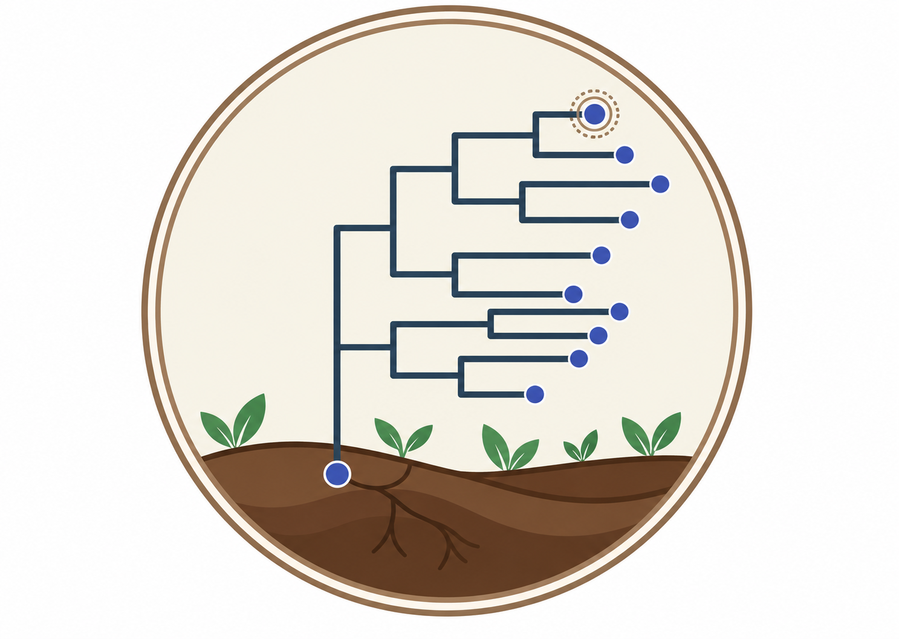
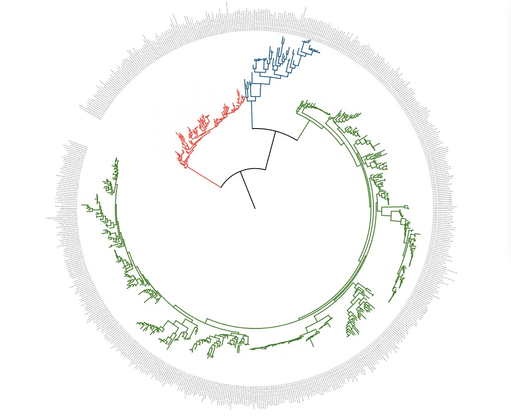

# Real Lab - Bacillota — exercício de filogenia e evolução de bacteriana

Este repositório contém material de apoio para a atividade a ser conduzida em sala de aula: **"Isolamento, identificação molecular e filogenia comparativa de bactérias ambientais"**, parte do Real Lab Day.

## Equipe

| Responsabilidade | Responsável |
|---|---|
| Coordenação | Profa. Dra. Rita de Cássia Café Ferreira |
| Co-orientação | Robson Francisco de Souza |
| Participação | Jansen de Araujo |
| Mediação | Gustavo de Oliveira Fenner |
| Suporte | Eduardo Gimenes |
| Suporte | Maria Luiza Andreani |
| Suporte | Celso Vítor Alves Queiroz Calomeno |

## Estrutura do repositório

- **`atividade/`** — roteiros e materiais da atividade prática (ex.: filogenia de 16S rRNA, passo a passo de bioinformática).
- **`suplementar/`** — materiais de apoio para a atividade, como árvores extras de comparação.
- **`materiais/`** — arquivos de apoio (tabelas, referências, planilhas) usados durante as análises.
- **`environment.yml`** — ambiente conda com as dependências necessárias para rodar as análises.
- **`.vscode/`** — configurações do editor para quem for rodar o código localmente.

## Sobre a atividade

A proposta é isolar, identificar e caracterizar filogeneticamente uma bactéria ambiental formadora de endósporo, integrando coleta em laboratório, sequenciamento Sanger (16S), análise filogenética e genômica comparativa do conjunto de genes de esporulação, com foco em *Bacillus* ambientais.
Ferramentas utilizadas

A linha de análise do isolado passa por um conjunto pequeno de programas, cada um resolvendo uma etapa específica:

Cromatograma (Chromas/Geneious) — leitura dos picos do sequenciamento Sanger, conferência da qualidade das bases e montagem do consenso.

NCBI — bancos de sequências e genomas de referência usados para identificação e busca de parentes.

BLAST (blastn/tblastn) — busca por similaridade, para encontrar as sequências mais próximas do consenso ou localizar genes específicos em um genoma.

MAFFT — alinhamento múltiplo, posicionando as bases homólogas entre todas as sequências.

Geneious / AliView — inspeção e edição manual do alinhamento antes da análise filogenética.

IQ-TREE2 — Algoritmo/programa de inferência da árvore por máxima verossimilhança.

Modelo de substituição (ex. GTR) — descreve as taxas relativas de troca entre nucleotídeos, usado pelo IQ-TREE2 para calcular a árvore mais provável.

Árvore de máxima verossimilhança — a topologia que, sob o modelo escolhido, melhor explica os dados observados.

A árvore de 16S da atividade

Essa árvore reúne os três grupos de sequências do roteiro de filogenia: em verde, os ~500 hits do BLAST do isolado ambiental (família Bacillaceae); em azul, os hits de Clostridium (família Clostridiaceae); em vermelho, os hits de E. coli e parentes (família Enterobacteriaceae, que inclui também Shigella e Salmonella). O nível de organização mais alto que dá pra discutir aqui é o de filo: Bacillaceae e Clostridiaceae pertencem ao mesmo filo (Bacillota/Firmicutes), enquanto Enterobacteriaceae é de outro filo (Pseudomonadota/Proteobacteria).